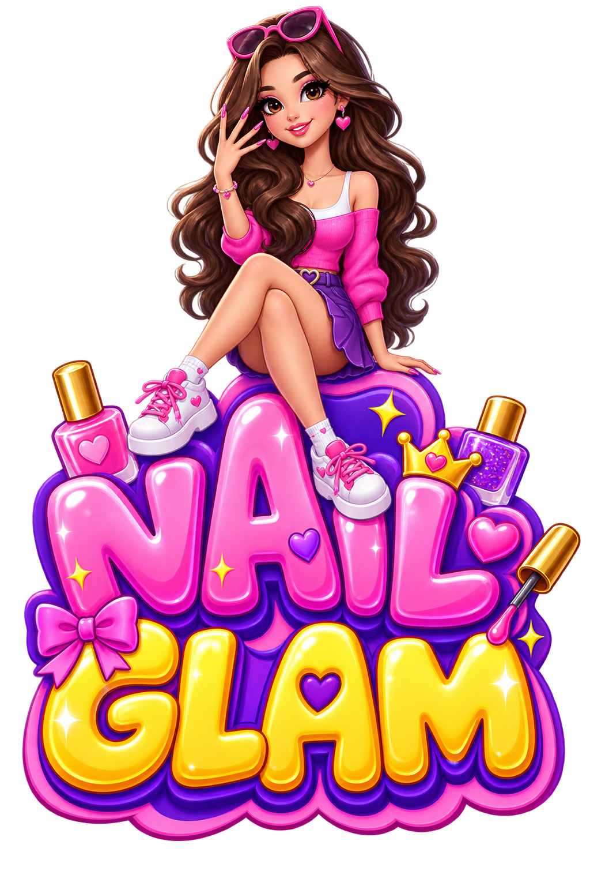

# 💅 Nail Glam

<p align="center">
  
</p>

<p align="center">
  <strong>A charming, high-performance 2D nail salon & spa simulation game built with Flutter & Flame Engine.</strong>
</p>

<p align="center">
  <a href="https://flutter.dev"></a>
  <a href="https://flame-engine.org"></a>
  <a href="https://dart.dev"></a>
  
  
</p>

---

## 📖 Table of Contents

- [Overview](#-overview)
- [Key Features](#-key-features)
- [Game Flow & Mechanics](#-game-flow--mechanics)
- [Architecture & Design](#-architecture--design)
- [Project Structure](#-project-structure)
- [Tech Stack & Dependencies](#-tech-stack--dependencies)
- [Getting Started](#-getting-started)
  - [Prerequisites](#prerequisites)
  - [Installation & Setup](#installation--setup)
  - [Running the Game](#running-the-game)
- [Asset & Sprite Pipeline](#-asset--sprite-pipeline)
- [Testing](#-testing)
- [Contributing & Code Standards](#-contributing--code-standards)
- [License](#-license)

---

## 🌸 Overview

**Nail Glam** is a casual beauty and salon simulation game where players run their own boutique nail spa. Guests arrive with distinct personalities and requests, inviting players to complete detailed, step-by-step manicure and pedicure procedures—from cleansing and sanitizing to clipping, buffing, shaping, and applying vibrant nail lacquers.

Built on the **Flame Engine** inside **Flutter**, the game combines smooth 60+ FPS 2D canvas rendering with responsive Flutter HUD overlays, rich audio, and a persistent salon upgrade economy.

---

## ✨ Key Features

### 💅 Comprehensive Nail Care & Spa Minigame
- **Hand (Manicure) & Foot (Pedicure) Care**: Freedom to choose hand or foot treatments per customer visit.
- **Realistic Multi-Stage Pipeline**:
  1. **Cleansing & Soaping**: Sudsy washing with custom hand and foot soaps.
  2. **Sanitizing & Spraying**: Disinfectant spray application.
  3. **Wiping & Buffing**: Smooth microfiber buffer treatment to prep nail plates.
  4. **Clipping & Trimming**: Animated nail clip tool with multi-frame cutting progression.
  5. **Shaping & Customization**: Multiple nail silhouettes including **Natural**, **Square**, and **Stiletto**.
  6. **Color & Lacquer Painting**: Real-time mask rendering and dynamic color application on individual digits.
  7. **Reveal Showcase**: Zoomed-out presentation of the finished look with celebratory customer reactions.

### 👥 Dynamic Client Roster & Interactive AI
- **Distinct Personalities**: Roster featuring unique characters (*Lila, Ezgi, Asta*) with individual dialogue, requests, and style preferences.
- **Custom Character Animations**: Bespoke sprite-sheet walk cycles, seating transitions, and easing curves.
- **Expressive Feedback**: Real-time emotion avatars and interactive thought bubbles reflecting customer mood and satisfaction.

### 🛋️ Salon Customization & Upgrade Shop
- **In-Game Economy**: Earn gold coins by delighting clients and completing services.
- **Salon Furniture Catalog**:
  - **Seating**: Starter chair, luxurious pink chairs, blush sofas, velvet loungers.
  - **Workstations**: Custom marble and luxury work tables that directly reflect in the manicure workstation view.
  - **Decor**: Ambient lamps, indoor plants, and vanity accents.
- **Tool Skin Upgrades**: Unlock premium soaps, designer spray bottles, and gold-plated nail clippers.

### 🎁 Progression & Player Retention
- **Daily Login Rewards**: Interactive daily reward calendar with streak multipliers and celebratory chest openings.
- **Visual Polish & Micro-Interactions**: Dynamic flying coin animations, confetti particle bursts, and smooth camera panning.
- **Persistent Save State**: Player wallet, inventory, equipped items, and daily streaks automatically persist via `shared_preferences`.

---

## 🎮 Game Flow & Mechanics

```
┌─────────────────────────────────────────────────────────┐
│                       Home Screen                       │
│       Daily Rewards • Salon Shop • How to Play          │
└───────────────────────────┬─────────────────────────────┘
                            │ (Tap Start)
                            ▼
┌─────────────────────────────────────────────────────────┐
│                     Client Arrival                      │
│     Guest walks in, sits down, and shares dialogue      │
└───────────────────────────┬─────────────────────────────┘
                            │ (Choose Service)
             ┌──────────────┴──────────────┐
             ▼                             ▼
   [ Manicure (Hand) ]            [ Pedicure (Foot) ]
   • Gentle hand wash             • Foot wash & soak
   • Digit-by-digit care          • Synchronized toe clip
   • Clip, buff & shape           • Buffer & sanitization
   • Polish painting              • Full-set lacquer
             └──────────────┬──────────────┘
                            │
                            ▼
┌─────────────────────────────────────────────────────────┐
│                     Final Reveal                        │
│      Customer reaction, coin payout & confetti burst    │
└─────────────────────────────────────────────────────────┘
```

---

## 🏗️ Architecture & Design

The project strictly follows the **Model-View-Controller (MVC)** architectural pattern to decouple game rules from presentation:

```
                  ┌───────────────────────┐
                  │    Flutter Overlays   │
                  │   & Flame Components  │
                  │        (View)         │
                  └───────▲───────┬───────┘
                          │       │
              State / UI  │       │ User Events &
                 Updates  │       │ Drag Gestures
                          │       ▼
                  ┌───────────────────────┐
                  │  NailCareController   │
                  │     NailGlamGame      │
                  │     (Controller)      │
                  └───────▲───────┬───────┘
                          │       │
             State Read & │       │ Write /
             Calculations │       │ Save Progress
                          │       ▼
                  ┌───────────────────────┐
                  │ PlayerProgress / Data │
                  │     Catalogs / Config │
                  │        (Model)        │
                  └───────────────────────┘
```

### Layer Responsibilities

| Layer | Directory | Responsibility | Examples |
| :--- | :--- | :--- | :--- |
| **Model** | `lib/model/` | Data structures, catalogs, sprite atlas definitions, and disk persistence. Zero UI dependencies. | `PlayerProgress`, `CustomerRoster`, `SalonCatalog`, `NailCareCatalog`, `SpriteAtlas` |
| **View** | `lib/view/` | Flutter HUD overlays, dialogs, shop screens, and Flame visual scene components. | `HomeOverlay`, `NailCareOverlay`, `ShopScreen`, `SalonScene`, `CustomerComponent` |
| **Controller** | `lib/controller/` | Game loop orchestration, phase management, camera direction, and audio. | `NailGlamGame`, `NailCareController`, `PlayerProgressController`, `CameraDirector`, `GameAudio` |

---

## 📁 Project Structure

```
nailGlam/
├── assets/                     # Game art, sprite sheets, UI icons & audio
│   ├── audio/                  # Background music & sound effects (SFX)
│   └── images/                 # PNG assets, masks, tables, chairs & tools
├── lib/
│   ├── main.dart               # App entry point, orientation lock & overlay router
│   ├── controller/             # State coordinators & game logic
│   │   ├── camera_director.dart       # Camera panning between lobby and workstation
│   │   ├── game_audio.dart            # Centralized BGM & sound effects controller
│   │   ├── home_controller.dart       # Navigation & menu state
│   │   ├── nail_care_controller.dart  # Minigame state machine (stages, digits, tools)
│   │   ├── nail_glam_game.dart        # Main Flame game loop & lifecycle
│   │   └── player_progress_controller.dart # Economy & shop purchase bridge
│   ├── model/                  # Data models, catalogs & game configurations
│   │   ├── asset_paths.dart           # Strongly-typed asset path constants
│   │   ├── customer_roster.dart       # Customer profiles, walk configs & dialogue
│   │   ├── game_config.dart           # Gameplay constants, timings & offsets
│   │   ├── nail_care_tools.dart       # Tool definitions, stages & digit state
│   │   ├── player_progress.dart       # Local-storage wallet & progression state
│   │   ├── salon_catalog.dart         # Salon decor items & tool skin catalogs
│   │   └── sprite_atlas.dart          # 2D sprite atlas coordinates & slicing definitions
│   └── view/                   # UI Overlays & Flame rendering components
│       ├── components/                # Flame visual components (SalonScene, NailWorkspace)
│       ├── home_overlay.dart          # Main menu overlay with Start and Shop buttons
│       ├── nail_care_overlay.dart     # Manicure & pedicure HUD with draggable tools
│       ├── shop_screen.dart           # Salon renovation & tool upgrade marketplace
│       ├── daily_reward_sheet.dart    # Daily login streak & reward modal
│       └── how_to_play_screen.dart    # Interactive minigame tutorial
├── test/                       # Comprehensive automated unit & widget test suite
├── tool/                       # Python & Dart scripts for sprite packing, defringing & masks
├── ARCHITECTURE.md             # In-depth architectural guidelines
├── analysis_options.yaml       # Strict Flutter & Dart lint rules
└── pubspec.yaml                # Project metadata, dependencies & asset registration
```

---

## 🛠️ Tech Stack & Dependencies

- **Framework**: [Flutter](https://flutter.dev) (v3.13.1+)
- **Game Engine**: [Flame](https://flame-engine.org) (`^1.38.0`) - High-performance 2D game loop, camera director, and component tree.
- **Audio**: [audioplayers](https://pub.dev/packages/audioplayers) (`^6.5.1`) - Multi-channel background music and low-latency interaction SFX.
- **Persistence**: [shared_preferences](https://pub.dev/packages/shared_preferences) (`^2.5.5`) - Local storage for coins, streaks, and owned items.
- **Code Quality**: [flutter_lints](https://pub.dev/packages/flutter_lints) (`^6.0.0`) - Recommended Dart and Flutter code standards.

---

## 🚀 Getting Started

### Prerequisites

Ensure you have the following installed on your machine:
- **[Flutter SDK](https://docs.flutter.dev/get-started/install)** (`>= 3.13.1`)
- **[Dart SDK](https://dart.dev/get-dart)** (`>= 3.1.0`)
- **IDE**: [VS Code](https://code.visualstudio.com/) or [Android Studio](https://developer.android.com/studio) with the Flutter & Dart plugins installed
- Target platform setup:
  - **Android**: Android SDK & Android Virtual Device / physical device
  - **iOS**: Xcode (macOS only)
  - **Desktop / Web**: Google Chrome or desktop build tools

### Installation & Setup

1. **Clone the repository**:
   ```bash
   git clone https://github.com/ezgiyigitt/nailGlam.git
   cd nailGlam
   ```

2. **Install project dependencies**:
   ```bash
   flutter pub get
   ```

3. **Verify environment**:
   ```bash
   flutter doctor
   ```

### Running the Game

Launch the application on your connected device or emulator:

```bash
# Run on default connected device
flutter run

# Run in release mode for optimal performance
flutter run --release

# Run specifically on Chrome (Web)
flutter run -d chrome

# Run specifically on Windows Desktop
flutter run -d windows
```

> **Note**: For mobile builds, the game automatically locks to **portrait mode** and activates full-screen immersive mode for the best play experience.

---

## 🎨 Asset & Sprite Pipeline

To ensure optimal mobile memory usage and 60 FPS rendering, Nail Glam utilizes a custom **Sprite Atlas pipeline**:
- **Atlas Slicing**: Sprite sheet coordinates are strictly defined in [`lib/model/sprite_atlas.dart`](lib/model/sprite_atlas.dart) to extract tool states, character frames, and nail masks from unified texture sheets.
- **Asset Processing Tools**: The `tool/` directory includes automated utilities for:
  - Extracting and alpha-masking nail outlines (`build_finger_nail_mask.py`, `build_toenail_mask.py`).
  - Defringing and cleaning character frame fringes (`defringe_light_finger_sheets.py`).
  - Assembling master sprite sheets for client walk and turn cycles (`pack_customer_fast.py`).

---

## 🧪 Testing

The repository features a comprehensive suite of unit, widget, and game integration tests:

```bash
# Run all automated tests
flutter test

# Run a specific test suite
flutter test test/nail_care_flow_test.dart
flutter test test/arrival_flow_test.dart
flutter test test/player_progress_test.dart
```

### Test Coverage Highlights
- **Minigame State Machine**: Validates tool sequencing, stage advancement, digit progression, and polish application.
- **Customer Lifecycle**: Asserts character arrival walk-in timing, seat easing, and dialogue completion.
- **Economy & Persistence**: Verifies coin calculations, shop purchases, and daily reward claims.
- **Responsive Viewport**: Tests camera framing and HUD alignment across diverse screen aspect ratios.

---

## 🤝 Contributing & Code Standards

Contributions are welcome! Please adhere to the following workflow:

1. **Fork the Repository** & create your feature branch:
   ```bash
   git checkout -b feat/my-awesome-feature
   ```
2. **Follow Code Conventions**:
   - Write clean, formatted code: `dart format .`
   - Ensure all lints pass: `flutter analyze`
   - Ensure all tests pass: `flutter test`
3. **Conventional Commits**: Use structured commit messages:
   - `feat: add new customer profile`
   - `fix: correct polish mask alignment`
   - `chore: update sprite atlas sheet`
   - `docs: update setup instructions in README`
4. **Open a Pull Request** with a detailed summary of your changes.

---

## 📄 License

This project is privately developed and maintained. For licensing, redistribution, or commercial inquiries, please contact the repository owners.

<p align="center">
  Crafted with care & glamour ✨
</p>
